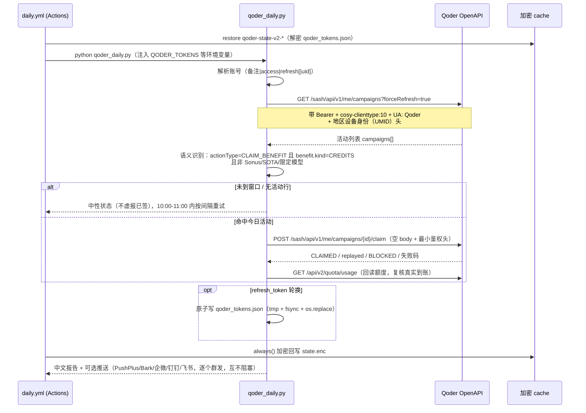

# Qoder 每日签到：流程拆解与 GitHub Actions 一键部署

> 面向 `1024210879/Qoder-Daily`（fork 自 `L0NE-6/Qoder-Daily`，当前 v1.0.17）。
> 本文只讲两件事：**它到底怎么签到**、**怎么用 `qoder_deploy.py` 一键部署到 GitHub Actions**。

---

## 0. 30 秒结论

| 问题 | 答案 |
|---|---|
| 签到是什么 | 每天北京时间 10:00 后，Qoder 会在账号里下发一条「每日 100 Credits」活动（`CLAIM_BENEFIT` + `CREDITS`），脚本调用 claim 接口把它领掉 |
| 靠什么鉴权 | `access_token`（Bearer）+ 可选 `refresh_token`（自动续期）+ **对应地区的官方设备身份**（UMID，风控用） |
| 最大坑是什么 | `refresh_token` 每次续期都会**轮换**。Actions 里必须靠加密 cache 把它带到下一轮，否则第二天就断了 |
| 一键部署做什么 | 开通 Actions → 浏览器授权拿 Token → 写 Secrets → 反注释 `schedule` 并提交 → 触发首跑 → 校验 cache 命中 |
| 当前仓库状态（实测） | Actions **从未启用**（`workflow_runs`/`workflows` 全空）；当前 gh 凭据 **写不了 Secrets**（403）—— 见 §7.1 |

---

## 1. 签到时序：一次运行的完整链路



关键设计点（决定了你排错时的方向）：

- **成功判据不是 HTTP 200**。只有真正 `CLAIMED` 并回读到额度变化才算成功；`replayed=true` 算今日已领；`RISK_DEPENDENCY_UNAVAILABLE`、`CAMPAIGN_NOT_ACTIVE` 一律中性上报。
- **HTTP 403 不等于登录失效**。`112` / 含 `pricingUrl` = 额度耗尽（冷却 30 分钟）；`110` / `Daily count exceeded` = 每日计费上限（冷却到零点）；只有非额度类 401/403 或业务码 `105` / `10019901001` 才触发续期。
- **claim 用最小鉴权头**（v1.0.16 起）。完整设备头反而会被判 `RISK_DEPENDENCY_UNAVAILABLE`，所以别"帮它补齐头"。
- **活动列表请求不带 `forceRefresh`**（v1.0.6）。那个参数是本地缓存标记，官方客户端不发送，带上会让服务端过滤掉每日活动行。

---

## 2. 双区域：完全隔离，不能混配

| 维度 | 中国版 CN | 国际版 Global |
|---|---|---|
| 网页 / 授权页 | `qoder.com.cn` | `qoder.com` |
| OpenAPI | `openapi.qoder.com.cn` | `openapi.qoder.sh` |
| Secrets 变量 | `QODER_TOKENS` | `QODER_GLOBAL_TOKENS` |
| Token 行格式 | `备注\|access\|refresh` | `备注\|access\|refresh\|uid`（uid 可省，脚本会从活动列表读） |
| 设备身份来源 | Qoder CN / `qoderclicn`，环境参数 `0` | Qoder / `qodercli`，环境参数 `3`（CLI/下载用 `4`） |
| 活动列表 | 一次拉取；空表时用最小四件套复取一次 | **两段式**：先无风控头读顶层 `uid`，再生成 UMID 二次拉取 |

> 用中国版组件跑国际版账号，结果不是报错，而是"鉴权成功但活动列表为空"——最容易误判成"今天没活动"。脚本在缺身份时会明确提示，不会编造签到成功。

CI 上通常不需要手工配 `QODER_MACHINE_*`：脚本会自动从官方 npm 包（`@qodercn-ai/qoderclicn` / `@qoder-ai/qodercli`）下载 `runtime-info` 组件、做 sha512 校验后提取。只有 runner 访问不了 npm 时，才用 `QODER_UMID_NO_INSTALL=1` + 手工 secret。

---

## 3. Token 生命周期：整套方案最脆弱的地方

```
qoder_login.py / 浏览器授权
        │  产出 access + refresh
        ▼
  QODER_TOKENS（Secret，静态）
        │  首次运行
        ▼
  qoder_tokens.json（runner 工作目录）
        │  always() 加密
        ▼
  .qoder-cache/state.enc → Actions cache（key: qoder-state-v2-{run_id}-{attempt}）
        │  下次运行 restore-keys 前缀命中
        ▼
  解密回 qoder_tokens.json → 用最新的 refresh 续期
```

四个必须知道的后果：

1. **不配 `QODER_CACHE_KEY` = 每天用回 Secret 里的旧 refresh**。而旧 refresh 在第一次轮换后就已经失效 → 第二次开始就登录失败。所以这个 key 是必配项，不是可选项。
2. **换 key = 清空历史**。新 key 解不开旧 cache，等于把轮换链掐断，必须重新授权一次。
3. **cache 会被淘汰**。GitHub 的 cache 7 天没被访问就清理；每天成功运行会持续续命，但停跑一周以上要留意。
4. **cache 写不进去不会报错**。`always()` 里的加密步骤如果静默失败，你要到第二天才发现。所以部署脚本专门加了「Stage 7 校验 cache 是否真的存在」。

只配 `access` 不配 `refresh` 也能跑，但 access 过期后必须重新跑一次授权。

---

## 4. 活动窗口与重试

| 参数 | 脚本默认 | `daily.yml` 覆盖 | 说明 |
|---|---|---|---|
| `QODER_WINDOW_RETRY` | `1`（开） | `1` | 10:00–11:00 CST 内是否补拉 |
| `QODER_WINDOW_RETRY_MAX` | `6` | `16` | 脚本内部硬上限是 **6**，写 16 也只会跑 6 次 |
| `QODER_WINDOW_RETRY_GAP` | `600` | `90` | 两次尝试间隔秒数 |

`cron: "5 2 * * *"` 是 UTC，对应北京 10:05 —— 开窗后 5 分钟，避开边界。GitHub 的 schedule 本身会有 5–20 分钟排队延迟，脚本的重试窗口就是为这个准备的。

---

## 5. 环境变量全表

### 5.1 账号

| 变量 | 格式 | 说明 |
|---|---|---|
| `QODER_TOKENS` | `access` / `access\|refresh` / `备注\|access\|refresh` | 中国版，多账号用换行或 `&` 分隔 |
| `QODER_GLOBAL_TOKENS` | `备注\|access\|refresh\|uid` | 国际版，uid 可省 |

> 备注里不要再写 `|`；以 `#` 开头的行会被忽略。

### 5.2 设备身份（CI 一般不用配）

| 变量 | 说明 |
|---|---|
| `QODER_MACHINE_TOKEN` / `QODER_MACHINE_CODE` / `QODER_MACHINE_TYPE` | 手工提供完整三件套 |
| `QODERCN_RUNTIME_INFO` / `QODER_RUNTIME_INFO` | 指定地区 `runtime-info` 组件路径 |
| `QODER_UMID_PATH` | 通用组件路径（优先于地区变量） |
| `QODER_UMID_NO_INSTALL` | `1` = 禁止自动下载提取 |
| `QODERCN_CONFIG_DIR` / `QODER_CONFIG_DIR` / `QODERCN_CLI_HOME` / `QODER_CLI_HOME` | 辅助查找本机客户端缓存 |

### 5.3 重试 / 缓存 / 推送

| 变量 | 默认 | 说明 |
|---|---|---|
| `QODER_WINDOW_RETRY*` | 见 §4 | 开窗补拉 |
| `QODER_CACHE_KEY` | 无 | **必配**，加密 Actions 里的 token 状态 |
| `PUSHPLUS_TOKEN` | 无 | PushPlus |
| `BARK_URL` | 无 | Bark（iOS） |
| `WECOM_WEBHOOK` | 无 | 企业微信群机器人（可只填 key） |
| `DINGTALK_WEBHOOK` / `DINGTALK_SECRET` | 无 | 钉钉机器人 + 加签 |
| `FEISHU_WEBHOOK` | 无 | 飞书群机器人（可只填 hook 后的 key）；交互卡片，绿=全成功 / 红=有失败 / 蓝=仅中性信息 |
| `QL_URL` / `QL_TOKEN` | 无 | 青龙原生通知 |

> 推送是**逐个群发**：配了几个就发几个，任一渠道失败不影响其它渠道。不配任何推送变量时行为与以前一致（只写日志）。

**飞书怎么配（一次）**

```bash
# 值走 stdin，不进 shell 历史，也不写进任何文件
printf '%s' '<webhook 地址>' | gh secret set FEISHU_WEBHOOK --repo <owner>/Qoder-Daily
```

想先在本地验证卡片效果（不写 Secret）：

```powershell
$env:FEISHU_WEBHOOK = '<webhook 地址>'
python -c "import qoder_daily as d; print(d.notify_feishu('🧭 Qoder 签到报告','账号1 主号: ✅ 今日签到成功，+100 credits'))"
Remove-Item Env:FEISHU_WEBHOOK
```

卡片颜色规则：正文含 `❌` → 红；否则含 `✅` → 绿；只有 `ℹ️`（今日已领 / 窗口未开）→ 蓝。正文超过 3000 字会截断并提示原文长度。

### 5.4 运行时产物（都不提交）

`qoder_tokens.json`、`qoder_machine_id`、`.qoder-cache/`、`qoder_umid/`、`*_result.json` —— 已被 `.gitignore` 忽略。

---

## 6. 三种部署方式怎么选

| 方式 | 成本 | 优点 | 缺点 |
|---|---|---|---|
| **GitHub Actions**（本文） | 零服务器，公开仓库免费 | 无需常驻设备；cache 可跨运行恢复；日志留档 | fork 的定时要先手工/API 启用；schedule 有排队延迟；60 天无活动会被停用 |
| 青龙面板 | 要一台常驻机器 | 面板可视化、通知生态成熟、cron 精确 | 要守着机器；token 状态存在脚本目录，需可写 |
| 本机（Windows 任务计划 / cron） | 电脑得开着 | 最简单、无时长限制 | 关机就漏签；休眠后可能不触发 |

---

## 7. 一键部署（GitHub Actions）

### 7.1 先修凭据（**当前环境实测这一项就没满足**）

```bash
gh api repos/1024210879/Qoder-Daily/actions/secrets
# 403 + X-Accepted-Github-Permissions: secrets=read   ← 就是权限不够
```

任选一条修法：

| 方案 | 命令 | 需要的权限 |
|---|---|---|
| gh OAuth 重新登录 | `gh auth login --web --scopes "repo,workflow"` | OAuth token 自带 `repo`+`workflow` |
| **classic PAT（国内网络首选）** | 浏览器建 https://github.com/settings/tokens/new 勾 `repo`+`workflow`，再 `set GH_TOKEN=...` | 覆盖 Actions secrets 读写与 workflow 文件提交 |
| fine-grained PAT | 给本仓库授权：Contents / Actions / Secrets / Workflows 均 Read and write，另加 Administration（仅自动开通 Actions 需要） | 否则 Actions 与 Secrets 接口一律 403 |

> `workflow` scope 是**改 `.github/workflows/*` 的必要条件**，classic PAT 缺了会返回 `404 without 'workflow' scope`。

> **`gh auth login --web` 报 `dial tcp ...:443 ... timeout` 怎么办？**
> `gh` 的网页登录打的是 `github.com/login/device/code`，而 API 走的是 `api.github.com` —— 国内网络常见"API 通、主站不通"。
> 此时不要和 gh 登录死磕，直接走 classic PAT（浏览器能打开 github.com 即可），拿到 token 后用 `GH_TOKEN` 环境变量喂给脚本：
>
> ```powershell
> $env:GH_TOKEN = "ghp_xxxxxxxx"          # 只对当前 PowerShell 会话有效
> gh api repos/1024210879/Qoder-Daily/actions/secrets   # 返回 total_count 就通了
> python qoder_deploy.py --dry-run
> ```
>
> 部署本身不需要本机能连 github.com：写 Secret、提交 workflow、触发运行、读日志全部走 `api.github.com`，签到跑在 GitHub 的 runner 上。

### 7.2 部署 9 步

```bash
cd D:\Project\Qoder-Daily

# 1) 只看计划（全程只读，不写 secret、不提交）
python qoder_deploy.py --dry-run

# 2) 完整部署：开通 Actions → 授权 → 写 Secrets → 开定时 → 首跑
python qoder_deploy.py

# 3) 出问题时逐步排查（推荐先小步验证）
python qoder_deploy.py --only-secrets --no-test-run --skip-schedule
python qoder_deploy.py --sync-schedule --no-test-run
python qoder_deploy.py --check          # 任何时候都能做的健康巡检
```

脚本会依次做这些事，每步都先读现状再决定写：

| 阶段 | 动作 | 失败时的表现 |
|---|---|---|
| 0 前置探测 | 读身份 / 仓库 / Actions 权限 / workflow / secrets / caches / 本地 workflow 文本 | 用 `X-Accepted-Github-Permissions` 精确指出缺哪个权限，退出码 5 |
| 1 开通 Actions | `PUT /actions/permissions {enabled:true}` → enable `daily.yml` → 复核 `total_count>0` | 无管理员权限时打印 UI 路径，退出码 10 |
| 2 设备授权 | 打开授权页（PKCE S256 + `machine_id`），2 秒轮询，最长 300 秒 | 401/403 判定"区域选错"，退出码 7 |
| 3 cache key | 复用本地 key / 生成新的 / `--rotate-cache-key` 时清旧 cache | — |
| 4 写 Secrets | `gh secret set`（值走 stdin）或 PyNaCl sealed box | 退出码 5，并给出上面那张权限表 |
| 5 开定时 | 拉 fork 的 `daily.yml` → 幂等判断 → 反注释 `schedule` → 带 sha 提交（409 自动重试） | `workflow` scope 不足时退出码 6，并可用 `--print-patch` 走网页手工 |
| 6 首跑 | `workflow_dispatch` → 轮询 run → 打印每个 step 与关键日志（已打码） | 失败给 run 链接，退出码 9 |
| 7 校验 cache | 检查 `qoder-state-v2-*` 是否真的生成 | 没生成则告警（否则明天才会发现） |

### 7.3 授权时要注意

- 浏览器授权页会在本机打开；如果没弹出来，复制终端里打印的 URL 手动打开。
- **区域要选对**：`qoder.com.cn` 的账号走中国版，`qoder.com` 走国际版。脚本在拿到 token 后会立即拉一次活动列表做校验，401/403 直接告诉你是区域选错。
- 多账号：同一区域追加行即可（`--tokens-file tokens.txt`），不要混区域。

### 7.4 部署完成后必须做的一件事

```bash
# 次日 10:05 之后
gh run list -R 1024210879/Qoder-Daily --event schedule --limit 3
```

fork 的 scheduled workflow 有"静默不触发"的历史问题（默认分支、Actions 被禁用、60 天无活动）。这一步不能省。

---

## 8. 故障速查

### 8.1 退出码对照

| 码 | 含义 | 先看哪里 |
|---|---|---|
| 0 | 完成 | — |
| 2 | 参数/交互问题 | `--help`；非交互环境记得 `-y` 或显式传参 |
| 3 | 运行环境缺失 | 没 gh 也没 `--pat`；或网络/DNS |
| 4 | 身份或仓库不匹配 | `gh auth status`；仓库是否真的是那个 fork |
| 5 | Secrets 权限不足 | §7.1 |
| 6 | workflow 写权限不足 | 缺 `workflow` scope；用 `--print-patch` 手工改 |
| 7 | Qoder 授权失败 | 区域选错 / 授权超时 / 网络 |
| 8 | 补丁失败 | `on:` 块结构被上游改过；看 diff 后手工改 |
| 9 | 首跑失败 | 展开 run 里失败的 step |
| 10 | Actions 无法启用 | 手工点 Settings → Actions → General |
| 11 | 状态文件异常 | `~/.qoder-deploy/state.json` 损坏，用 `--state-file` 换路径 |
| 12 | 部分成功 | 按提示补做剩余步骤，脚本可重入 |

### 8.2 常见现象

| 现象 | 大概率原因 | 处理 |
|---|---|---|
| 日志显示鉴权成功但 `campaigns: []` | 缺对应地区的设备身份 / 用了错误的区域组件 | 检查 UMID；国际版确认 uid 是否读到 |
| 每天第一次成功、之后连续失败 | refresh 轮换后 cache 没恢复 | 查 `QODER_CACHE_KEY` 是否配、cache 是否存在、`Encrypt token state` 是否执行 |
| HTTP 403 但账号明明有效 | 额度耗尽（112）/ 日计费上限（110） | 不是登录问题，等冷却即可 |
| `schedule` 配了但从不触发 | fork 的 Actions 被停用 / 不在默认分支 / 60 天无活动 | §7.4 检查；重新 enable workflow |
| 首跑 404 | workflow 未启用 | 跑 `--sync-schedule`，或手工点 enable |
| `RISK_DEPENDENCY_UNAVAILABLE` | 风控依赖不可用 | 别补设备头，脚本已用最小鉴权头；换时间重试 |

### 8.3 换账号 / 加账号 / 撤销

```bash
# 换账号：重新授权覆盖同名 secret
python qoder_deploy.py --region cn --only-secrets

# 加账号：先在文件里写好两行，再一次性写入
python qoder_deploy.py --tokens-file tokens.txt --only-secrets

# 彻底撤销：删 secret + 停 workflow + 清 cache（网页操作最直观）
gh secret delete QODER_TOKENS -R 1024210879/Qoder-Daily
gh secret delete QODER_CACHE_KEY -R 1024210879/Qoder-Daily
```

---

## 9. 脚本自身的开关

| 参数 | 作用 |
|---|---|
| `--dry-run` | 只探测 + 打印计划（含 workflow diff、将写入的 secret 名），零写入 |
| `--only-secrets` | 只走授权 + 写 Secret |
| `--sync-schedule` | 只做「开通 Actions + 反注释 schedule」 |
| `--skip-schedule` | 完全不碰 workflow 文件 |
| `--no-test-run` | 不触发首跑 |
| `--print-patch` | 生成 `daily-schedule.patch`，供 `git apply` 或手工对照 |
| `--check` | 健康巡检（schedule 状态、最近 run、cache、secret 名单） |
| `--cache-key` / `--rotate-cache-key` | 指定 / 强制更换 `QODER_CACHE_KEY` |
| `--tokens-file` | 用现成 token 行，跳过浏览器授权 |
| `--set-secret NAME=VALUE` | 额外写 secret（如 `PUSHPLUS_TOKEN=...`），可重复 |
| `--no-gh` | 不依赖 gh，改用 PyNaCl 加密（需 `pip install pynacl`） |
| `--self-test` | 离线自检（补丁逻辑、掩码、权限头解析等 20 项） |
| `-y` / `--json` / `--verbose` | 非交互 / 机器可读输出 / 调试日志 |

脚本对仓库的写入范围是**白名单**：只允许改 `.github/workflows/daily.yml` 一个文件；状态与密钥一律落在 `~/.qoder-deploy/state.json`（0600，原子写），不进仓库。

---

## 10. 合规与边界

- 本项目用于个人学习与自动化实践，请遵守 Qoder 及相关服务条款，账号风险自担。
- 仓库 `NOTICE.md` 明确反对倒卖/二次封装收费，遇到收费版本请直接回到上游仓库。
- 不要提交 Token 文件、不要把 Secret 贴进 Issue、不要在日志里粘贴完整授权头。
- 自动化签到本身不产生内容，也不绕过任何付费墙；它只领取官方主动下发的活动额度。
